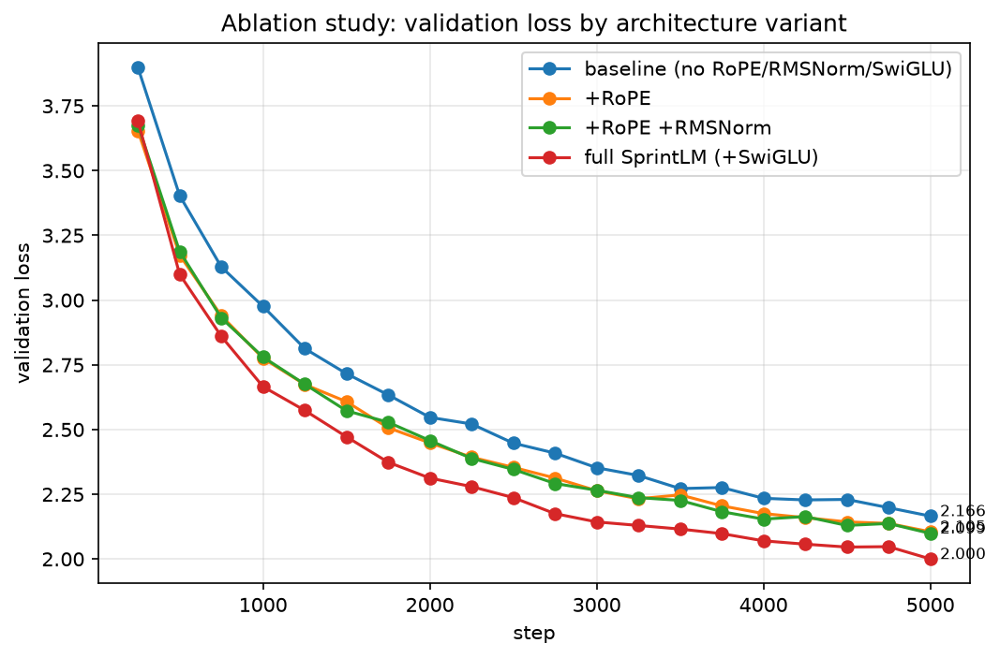

# From-Scratch Transformer Ablations

A decoder-only transformer implemented from scratch in PyTorch (RoPE,
RMSNorm, SwiGLU, multi-head causal attention), extending Stanford CS336
Assignment 1: "Transformers from Scratch." Trained on TinyStories, with a
controlled 4-variant architecture ablation study, a seed-variance check,
and correctness-verified KV-cached inference with a measured
latency/throughput benchmark.

## Results at a glance

| metric | value |
|---|---|
| final validation loss | **2.0216** |
| final validation perplexity | **7.55** |
| tokens seen | ~23M |
| throughput | ~2.2k tok/s steady-state |
| hardware | 1× RTX 3050 Laptop GPU (4GB VRAM) |
| wall time | ~2.5 hours |
| non-embedding parameters | 28.32M |

### Ablation study

| variant | RoPE | RMSNorm | SwiGLU | val loss | val ppl |
|---|---|---|---|---|---|
| baseline | ✗ | ✗ | ✗ | 2.1657 | 8.72 |
| +RoPE | ✓ | ✗ | ✗ | 2.1050 | 8.21 |
| +RoPE +RMSNorm | ✓ | ✓ | ✗ | 2.0987 | 8.16 |
| full model | ✓ | ✓ | ✓ | **2.0002** | **7.39** |



**Interpretation.** RoPE gave the largest single-component jump over the
learned-positional-embedding baseline (8.72 → 8.21 ppl, ~6%). RMSNorm's
effect on top of RoPE was marginal (8.21 → 8.16, ~0.6%) — consistent with
RMSNorm's usual role being training stability/speed rather than a large
final-loss improvement. SwiGLU produced the largest jump of the three
(8.16 → 7.39, ~9.4%), and this advantage is visible from early in training
onward, not just at the final checkpoint. One caveat: the full model also
has more parameters than the other three variants (28.32M vs. ~21.3M
non-embedding params, since SwiGLU uses three weight matrices vs.
GELU-MLP's two), so part of its advantage is plausibly attributable to
capacity rather than purely the gating mechanism — a cleaner ablation
would match parameter count exactly across variants.

**Qualitative check.** Sampling both the baseline and full checkpoints on
the same prompt showed the full model's perplexity advantage did *not*
translate into an unambiguously more coherent 120-token sample — both
outputs had their own local logical inconsistencies. Perplexity measures
local next-token predictability, not global narrative coherence, and a
single sample per variant is not a rigorous coherence evaluation.

### KV-cache inference benchmark

**Within the context window** (generation lengths 32–160, under the
192-token limit), the cache gave essentially no measurable speedup at this
model's scale — throughput ratios hovered at 0.95x–1.14x across all tested
lengths, i.e. noise-level:

| new tokens | no-cache tok/s | kv-cache tok/s | speedup |
|---|---|---|---|
| 32 | 71.5 | 81.3 | 1.14x |
| 64 | 94.4 | 90.0 | 0.95x |
| 96 | 89.0 | 87.8 | 0.99x |
| 128 | 82.0 | 83.4 | 1.02x |
| 160 | 85.7 | 87.0 | 1.02x |

**Beyond the context window** (generation length 256, past the 192-token
limit), the lack of cache-eviction logic causes a clear, reproducible
regression:

| new tokens | no-cache tok/s | kv-cache tok/s | speedup |
|---|---|---|---|
| 256 | 64.7 | 28.9 | **0.46x** |

This does not mean the cache is broken — it is unit-tested for
bit-identical output against uncached greedy decoding (see
`test_kv_cache_matches_no_cache_greedy`). It means that at 28M parameters
and a 192-token context, the O(T²) attention cost the cache is designed to
avoid is not yet the per-step bottleneck; fixed costs (linear projections,
Python/CUDA per-step overhead) likely dominate at this scale instead. Past
the context window, the cached path pays the same full-window recompute
cost as the uncached path, plus extra cache-management overhead, for every
token past position 192.

## Architecture

| | |
|---|---|
| vocab | ≈50k (GPT-2 BPE via tiktoken) |
| d_model | 384 |
| layers | 12 |
| heads | 6 |
| d_ff | 1536 (SwiGLU gated) |
| context | 192 tokens |
| positional encoding | RoPE (θ=10000) |
| normalization | RMSNorm (pre-norm) |
| attention | masked multi-head, causal, `F.scaled_dot_product_attention` |

## Training configuration

| | |
|---|---|
| optimizer | AdamW |
| lr | 3e-4 (min 3e-5) |
| betas | (0.9, 0.95) |
| weight decay | 0.1 (excluded for norm/bias/1-D params) |
| schedule | warmup 100 steps → cosine decay |
| batch size | 24 |
| steps | 5000 |
| seed | 7 |

## Folder structure

```
sprintlm/
├── pyproject.toml
├── requirements.txt
├── main.py
├── README.md
│
├── configs/
│   ├── model/
│   │   ├── baseline.yaml
│   │   ├── rope_only.yaml
│   │   ├── rope_rmsnorm.yaml
│   │   └── full.yaml
│   └── train/
│       └── default.yaml
│
├── src/sprintlm/
│   ├── __init__.py
│   ├── config.py
│   ├── model.py
│   ├── data.py
│   ├── train/
│   │   ├── __init__.py
│   │   └── train.py
│   └── inference/
│       ├── __init__.py
│       └── kv_cache.py
│
├── tools/
│   ├── prepare_hf.py
│   ├── decode_cli.py
│   ├── benchmark_inference.py
│   ├── run_ablations.py
│   ├── seed_variance.py
│   ├── plot_metrics.py
│   ├── plot_ablation_comparison.py
│   └── peek_data.py
│
├── tests/
│   ├── test_model.py
│   └── test_data.py
│
├── data/
│   └── Prepared/TinyStoriesHF/
│       ├── train.bin
│       └── val.bin
│
└── outputs/
    ├── ablation_results.md
    ├── ablation_comparison.png
    ├── seed_variance.md
    └── <run_name>/
        ├── config.yaml
        ├── metrics.jsonl
        ├── inference_benchmark.md
        ├── ckpts/
        │   └── step*.pt
        └── assets/
            ├── loss_train.png
            ├── loss_val.png
            └── tokps.png
```

## Reproducing these results

```bash
pip install -r requirements.txt
pip install -e .
```

**1. Prepare the dataset:**
```bash
python tools/prepare_hf.py dataset_name=roneneldan/TinyStories text_field=text out_dir=data/Prepared/TinyStoriesHF append_eot=true dtype=uint16 tokenizer_name=gpt2
```

**2. Train the full model:**
```bash
python -m sprintlm.train.train dataset.train_bin=data/Prepared/TinyStoriesHF/train.bin dataset.val_bin=data/Prepared/TinyStoriesHF/val.bin train.batch_size=24 dataset.context_length=192 train.max_steps=5000 train.log_every=50 train.eval_every=250 train.save_every=250
```

**3. Run the ablation ladder:**
```bash
python tools/run_ablations.py dataset.train_bin=data/Prepared/TinyStoriesHF/train.bin dataset.val_bin=data/Prepared/TinyStoriesHF/val.bin train.max_steps=5000 train.seed=7
```

**4. Plot the ablation comparison:**
```bash
python tools/plot_ablation_comparison.py
```

**5. Benchmark KV-cache inference:**
```bash
python tools/benchmark_inference.py --ckpt outputs/full_sprintlm_seed7/ckpts/step5000.pt --lengths 32 64 96 128 160 --repeats 5
```

**6. Sample text from a checkpoint:**
```bash
python tools/decode_cli.py --ckpt outputs/full_sprintlm_seed7/ckpts/step5000.pt --prompt "Once upon a time, " --context_length 192 --temperature 0.8 --top_k 40 --use_cache
```

**7. Run the test suite:**
```bash
pytest tests/ -v
```
`test_kv_cache_matches_no_cache_greedy` is the most important test in the
suite: with greedy sampling, cached and uncached decoding must produce
bit-identical token sequences — this is the correctness guarantee that
makes the benchmark numbers meaningful.

## Limitations

TinyStories domain only (child-story register); not instruction-tuned;
KV-cache has no sliding-window eviction, causing a measured regression
beyond the context window; GPT-2 BPE only; no dataset dedup beyond what
TinyStories ships with; ablation study confounds architecture change with
parameter count for the SwiGLU comparison.

## Possible next steps

Compute-scaling sweep (loss vs. parameter count at fixed token budget);
int8/GGUF quantization with a quality-vs-speed table; sliding-window
KV-cache eviction; parameter-matched ablation variants; minimal C++ CPU
inference path.

## Attribution

This project extends the public **Stanford CS336 — Assignment 1:
"Transformers from Scratch"** assignment structure. The ablation ladder,
seed-variance methodology, KV-cache implementation and benchmark, and the
reproducibility scaffolding are original additions on top of that base.
